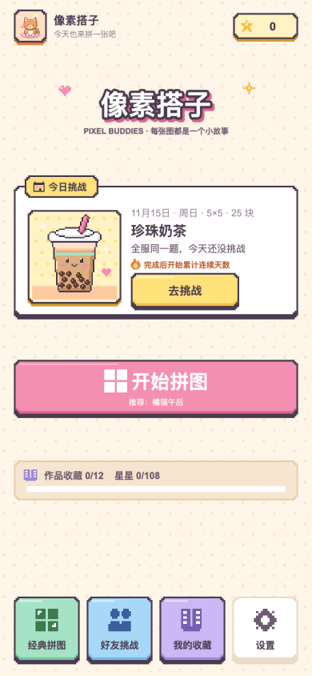
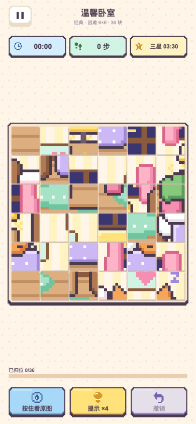
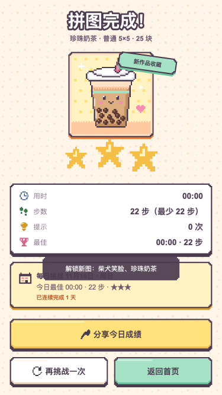
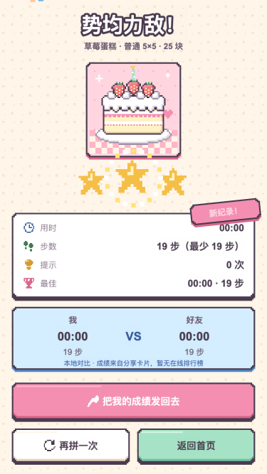

# 像素搭子（Pixel Buddies）

> 每张图片都可以成为一个故事，每个拼图都可以成为一次挑战。

一款竖屏轻度像素拼图小游戏，目标平台为 **微信小游戏** 与 **抖音小游戏**。
技术栈：Cocos Creator 3.8 + TypeScript，界面全部使用引擎原生 UI 组件（Sprite / Label / Graphics / Mask / Tween）在代码中构建。


| 首页 | 游戏（6×6） | 每日挑战结算 | 好友挑战对比 |
|---|---|---|---|
|  |  |  |  |

（以上为 Cocos Creator 3.8.8 web-mobile 构建在浏览器中的实际运行截图）

---

## 1. 当前状态（请先读）

| 项目 | 状态 |
|---|---|
| 核心逻辑（打乱、交换、判定、计时、星级、存档、每日、挑战码） | 已完成，43 项 Node 单元测试全部通过 |
| 全部游戏脚本 | 已完成，在 `@cocos/creator-types@3.8.8`（官方引擎类型）下 **strict 模式编译零错误** |
| 微信 API 使用 | 编译期对照微信官方 `minigame-api-typings` 校验通过（拼错接口名会编译失败） |
| 抖音 API 使用 | 依据抖音开放平台小游戏文档（2026-11 核对）实现，有模拟测试；**无官方 TS 类型可做编译校验** |
| 12 张原创像素图 + 图标 + 音效 | 已完成，全部由程序生成 |
| Cocos Creator 3.8.8 命令行构建（web-mobile / 微信 / 抖音） | ✅ 三个平台都构建成功；release 包约 2.2MB（低于 4MB 主包上限） |
| Web 构建实际运行 | ✅ 已在浏览器中玩通：经典 4×4 / 6×6、每日挑战、好友挑战完整闭环、暂停/后台、存档刷新保留，8 个页面都截图检查过 |
| 微信/抖音开发者工具、真机 | **未验证**：本机没有两个开发者工具，也需要你的 AppID |
| 平台审核 / 发布 | 未提交，未发布 |

截图见 `docs/screenshots/`。命令行构建配置在 `tools/build-configs/`（第 4 节）。

---

## 2. 功能一览

- **经典拼图**：方块交换式拼图（不是只有一个空格的 15 数字推盘）。按住拖到另一块上交换，或者先点一块再点另一块交换。支持 4×4 简单、5×5 普通、6×6 困难。
- **打乱保证**：Fisher–Yates 打乱之后再消除“开局就在正确位置”的方块。布局一定是完整排列：不丢块、不重复、不会是已完成状态，而且必定可解（交换式拼图没有奇偶性无解问题）。
- **计时与评分**：从第一次触碰方块开始计时。暂停和进入后台时冻结计时。星级取时间、步数、提示三项中最低的一项；阈值按难度单独配置，步数阈值按“最优步数”的比例计算，不同打乱结果之间公平。
- **辅助**：按住看原图（不影响星级）、定位提示（每局有限次，影响星级）、撤销（不计步）、“三星剩余时间”。
- **每日挑战**：题目完全由日期决定。每 12 天为一轮，每轮对全部图片做一次确定性洗牌，相邻两天一定是不同的图。重启游戏题目不变。记录个人最佳、连续完成天数、近 7 天情况，并生成结果卡片。
- **好友异步挑战**：挑战码包含图片 ID、难度、种子、版本号、发起者成绩和校验值。好友通过分享卡片的 query 或粘贴挑战码，会得到完全相同的题目。结算时显示双方成绩，并明确标注“本地对比，暂无在线排行榜”。
- **作品收藏册**：按动物、食物、生活、自然四个分类展示。没收集的作品显示马赛克剪影；收集后可以查看大图、小故事和各难度的最佳成绩。
- **解锁进度**：4 张默认开放，其余按总星数逐步开放。
- **本地存档**：带版本号的存档，包含 v1→v2 迁移、损坏备份、写入失败提示。
- **设置**：音乐、音效、振动开关，重看教程，清除存档（二次确认），隐私与平台状态说明。
- **新手教程**：第一局显示手势动画提示。
- **动画与音效**：选中放大、拖动跟手、交换补间、归位弹跳加闪光、已锁定方块轻摇、完成时缝隙闭合加纸屑、三星光环、按钮按压回弹、页面淡入位移过渡；7 个音效加循环 BGM。
- **平台适配**：Web、微信、抖音三套适配器，统一接口，每个能力都先检测再调用，不支持时优雅降级。
- **预留能力**：照片转像素画算法（本地运行，已测试）、激励视频与插屏广告（默认禁用）、服务器排行榜接口、数据分析上报通道。

---

## 3. 打开与运行

### 3.1 环境

- **Cocos Creator 3.8.8**（`package.json` 中 `creator.version`）。3.8.2 及以上都应能打开；3.8.0、3.8.1 也做了兼容（文字描边会自动改用 `LabelOutline` 组件）。
- 通过 [Cocos Dashboard](https://www.cocos.com/creator-download) 安装编辑器。

### 3.2 打开项目

1. 打开 Cocos Dashboard，选择 **项目 → 导入**，选中 `PixelBuddies` 文件夹。
2. 首次打开时，编辑器会生成 `library/`、`temp/`，并为没有 `.meta` 的资源补全 `.meta`。这是正常现象。
3. 在资源管理器中双击 `assets/scenes/Main.scene`。
4. 点击顶部的 **预览** 按钮（浏览器预览）。建议把预览设备设为 iPhone 12/13（390×844）或其他竖屏机型。

### 3.3 如果场景加载异常（兜底）

`Main.scene` 只包含 `Canvas → Camera` 和 `Canvas → GameRoot` 两个节点，所有界面都由 `GameRoot` 组件在运行时用代码搭建。

- 如果提示 `GameRoot` 组件丢失：只要场景里有 Canvas，`GameRoot.ts` 末尾的兜底引导会在运行时自动把组件挂上去。你也可以在 Canvas 下新建空节点，手动添加 `GameRoot` 组件。
- 如果场景文件本身无法解析：新建一个 2D 场景（自带 Canvas 和 Camera），保存为 `assets/scenes/Main.scene`，在 Canvas 下新建节点并挂 `GameRoot` 组件即可，不需要其他任何配置。

### 3.4 工具链（不参与构建）

`tools/` 目录用于类型检查、单元测试、生成像素图预览和音效：

```bash
cd tools && npm install
```

```bash
cd tools && npm run verify
```

`npm run verify` 依次执行：引擎类型检查 → 微信 API 兼容检查 → 单元测试。

```bash
cd tools && npm run art
```

```bash
cd tools && npm run audio
```

`npm run art` 导出 `art-preview/*.png`；`npm run audio` 重新生成 `assets/resources/audio/*`。

---

## 4. 构建微信小游戏

1. 在 [微信公众平台](https://mp.weixin.qq.com/) 注册小游戏，拿到 **AppID**。
2. 安装 [微信开发者工具](https://developers.weixin.qq.com/minigame/dev/devtools/download.html)。
3. Cocos Creator → **项目 → 构建发布**：
   - 发布平台：**微信小游戏**
   - 初始场景：`db://assets/scenes/Main.scene`（勾选参与构建的场景）
   - 设备方向：**Portrait（竖屏）**
   - AppID：填你的微信小游戏 AppID
   - 建议勾选：MD5 缓存；纹理压缩可以不开（作品都是运行时生成的小纹理）
4. 点击 **构建**，完成后点 **运行**，或用微信开发者工具打开 `build/wechatgame`。
5. 包体：项目已在 `settings/v2/packages/engine.json` 中做了功能裁剪，只保留 2D、UI、Graphics、Mask、音频、Tween。release 构建实测约 2.2MB；如果不裁剪（引擎默认全模块加 debug），约 8.9MB，会超过主包上限。

也可以用命令行构建（Cocos CLI 退出码 36 表示构建成功）：

```bash
/Applications/Cocos/Creator/3.8.8/CocosCreator.app/Contents/MacOS/CocosCreator --project "$(pwd)" --build "configPath=$(pwd)/tools/build-configs/wechatgame.release.json"
```

`tools/build-configs/` 中有 web-mobile、wechatgame、bytedance-mini-game 三个平台的 debug 和 release 配置。AppID 是占位值，请先换成你的。

**AppID 位置**：以构建面板为准。`assets/scripts/config/PlatformConfig.ts` 中的 `WECHAT_CONFIG.appId` 只是标识占位，不参与鉴权。

## 5. 构建抖音小游戏

1. 在 [抖音开放平台](https://developer.open-douyin.com/) 创建小游戏，拿到 **AppID**。
2. 安装抖音开发者工具。
3. Cocos Creator → **构建发布**：
   - 发布平台：**抖音小游戏**（bytedance-mini-game）
   - 初始场景：`Main.scene`；设备方向：竖屏；AppID：填你的抖音 AppID
4. 构建后，用抖音开发者工具打开 `build/bytedance-mini-game`。
5. 分享配置：抖音分享图取自后台的 **运营能力 → 分享配置**，或审核通过的 `templateId`。拿到后填入 `DOUYIN_CONFIG.shareTemplateId`。

---

## 6. 填写发行配置

文件：`assets/scripts/config/PlatformConfig.ts`（目前全部为占位值，没有任何真实 ID）

| 字段 | 说明 |
|---|---|
| `WECHAT_CONFIG.appId` / `DOUYIN_CONFIG.appId` | 仅作标识。真实 AppID 填在构建面板 |
| `*.ads.rewardedVideo` / `*.ads.interstitial` | 广告位 ID，留空 = 未接入 |
| `*.shareTemplateId` | 微信 `imageUrlId` / 抖音 `templateId`，需后台审核通过 |
| `*.shareImageUrl` | 自定义分享图，留空则由平台用默认图 |
| `RELEASE.adsEnabled` | 广告总开关，默认 `false` |
| `RELEASE.leaderboardEndpoint` | 服务器排行榜地址（预留），留空 = 仅本地成绩 |

## 7. 接入广告

1. 微信需开通 **流量主**（有用户量门槛）；抖音需开通 **广告变现**。在后台创建激励视频广告位（可选：插屏广告位）。
2. 把广告位 ID 填入 `PlatformConfig.ts`，并把 `RELEASE.adsEnabled` 改为 `true`。
3. 统一入口是 `assets/scripts/ads/AdManager.ts`：
   - `isRewardedAvailable()` 返回 false 时，界面不会出现任何看广告入口。
   - 只有平台回调 `isEnded === true` 才发奖励；加载失败会如实提示。
   - 插屏广告只在“结算页 → 首页”这种自然切换点调用，至少间隔 2 分钟，拼图过程中绝不调用。
4. 发放额外提示：在 `GamePage.rewardHint()` 收到 `rewarded` 后，给 `PuzzleManager` 增加提示额度（例如加一个 `grantExtraHint()` 方法），再补一条对应的单元测试。

## 8. 需要开发者账号或平台审核的功能

| 功能 | 需要 |
|---|---|
| 真机运行、上传体验版 | 微信/抖音小游戏 AppID |
| 分享卡片自定义图片 | 微信：分享图审核（`imageUrlId`）；抖音：分享配置 / `templateId` 审核 |
| 激励视频、插屏广告 | 微信流量主 / 抖音广告变现开通，以及广告位 ID |
| 正式发布 | 两个平台的版本审核；游戏类目可能需要相关资质（如软著），以平台要求为准 |
| 在线排行榜 | 自建服务器，或平台开放数据域 |
| 照片转像素 | 开放前需在隐私协议中声明相册/相机用途，并配置平台的隐私接口授权 |

---

## 9. 目录结构

```
PixelBuddies/
├── package.json                 # Cocos 项目描述（creator.version = 3.8.8）
├── tsconfig.json                # 继承编辑器生成的 temp/tsconfig.cocos.json
├── settings/v2/packages/project.json   # 设计分辨率 720×1280，宽度适配
├── assets/
│   ├── scenes/Main.scene        # 唯一场景：Canvas + Camera + GameRoot
│   ├── resources/audio/         # 音效（WAV）与 BGM（MP3），程序合成
│   └── scripts/
│       ├── config/              # GameConfig（难度/评分/每日/挑战）、PlatformConfig（占位发行配置）
│       ├── core/                # GameRoot 入口、GameManager 服务容器、SceneManager 页面管理、计时器、随机数、事件
│       ├── puzzle/              # PuzzleGenerator/Shuffle/Validator/Scoring/Manager（纯逻辑） + PuzzleBoard/PuzzlePiece（视图）
│       ├── daily/               # 每日挑战（纯逻辑）
│       ├── social/              # 挑战码编解码、挑战管理、分享文案
│       ├── collection/          # 纪录、收藏、解锁
│       ├── storage/             # 存档结构、版本迁移、读写
│       ├── platform/            # PlatformAdapter 接口 + Browser/WeChat/Douyin 实现
│       ├── audio/  ads/  analytics/  imaging/
│       ├── art/                 # 调色板、像素光栅库、12 张作品绘制程序、纹理工厂
│       ├── ui/                  # 主题、像素 UI 组件、滚动列表、特效、图标
│       └── pages/               # 首页、经典、游戏、结算、每日、收藏、设置、好友挑战
├── art-preview/                 # 作品 PNG 预览（由 tools 生成，不参与构建）
├── tools/                       # 类型检查、单元测试、美术/音频生成（不参与构建）
└── docs/                        # 测试报告、发行清单
```

### 与需求文档中建议结构的差异（有意为之）

- **单场景多页面**：需求里建议了 Main / Puzzle / Result / Collection 四个场景。小游戏上切换场景要重新加载、容易白屏，所以改为一个场景加 `SceneManager` 页面切换（淡入 + 位移过渡）。各页面在 `pages/` 下仍然一页一个文件。
- **代码化 UI，不用预制体**：Button / PuzzlePiece / ResultCard 改由 `ui/UIKit.ts` 与 `puzzle/PuzzlePiece.ts` 代码生成，风格统一、便于对比修改，也不需要维护大量 `.prefab` 的 UUID 引用。方块使用 `NodePool` 对象池复用。
- **像素图程序生成**：作品不是 PNG 资源，而是 `art/PuzzleArt.ts` 运行时绘制成 60×60 纹理，使用最近邻过滤，放大后依旧锐利。包体几乎为零，也和照片转像素功能共用同一条“像素缓冲 → 纹理”管线。

### 架构原则

- `puzzle/`、`daily/`、`social/`、`collection/`、`storage/`、`platform/`、`imaging/`、`art/PuzzleArt.ts` 都不依赖 `cc`，可以在 Node 中直接测试。
- 核心逻辑从不调用 `wx` / `tt`，所有平台能力都经过 `PlatformAdapter`。
- `PlatformFactory` 只有在“引擎平台标识”和“全局对象”同时存在时才启用对应平台，否则使用 Web 适配，缺 SDK 不会崩溃。

---

## 10. 后续扩展建议

- 照片转像素：`imaging/PixelArtConverter.ts`（已测试），以及平台层的 `chooseImage()` / `decodeImage()`。要接入 UI，需要新增一个“像素工坊”页面：选图 → 转换 → `TextureFactory.custom()` → 生成挑战。开放前请先完善隐私协议。
- 服务器排行榜：实现 `social/ChallengeManager.ts` 中的 `LeaderboardService` 接口，并填写 `leaderboardEndpoint`。
- 每日挑战统一日期：接入服务器后，把 `DailyChallengeManager` 的 `today` 注入改为服务端时间。
- 更多作品：在 `ArtCatalog.ts` 增加条目，在 `PuzzleArt.ts` 增加绘制函数即可。单元测试会自动检查新作品的 ID、分类和绘制结果。
